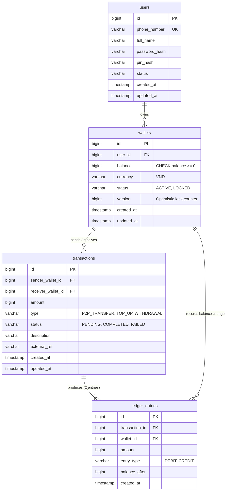
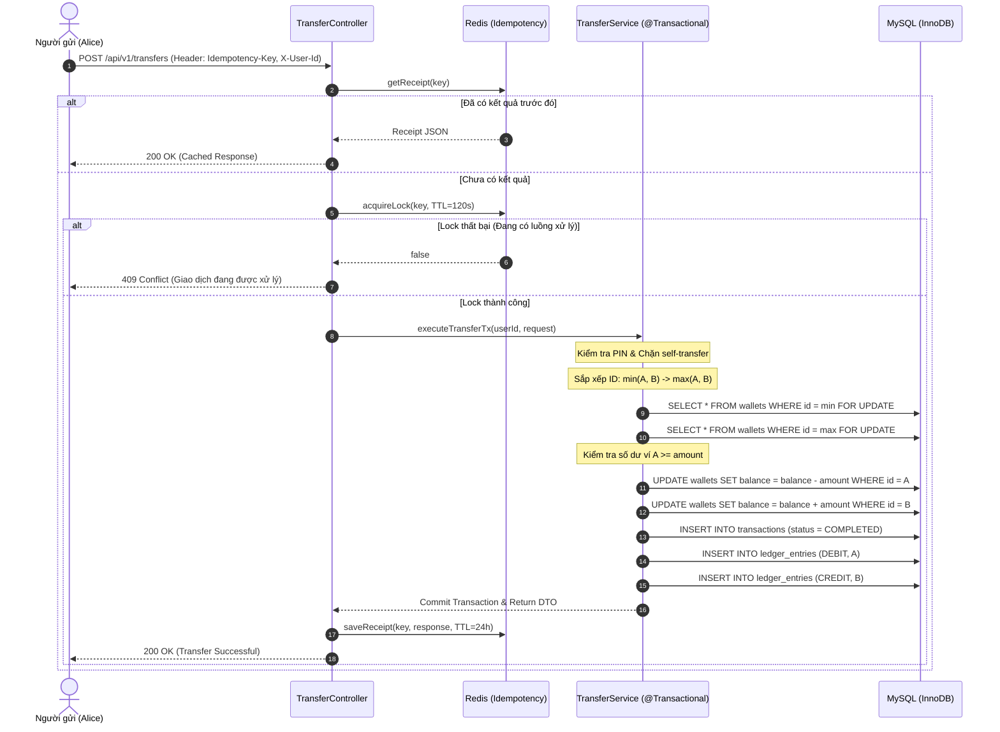

# 💳 E-Wallet Core Engine (`vwallet`)

[](https://openjdk.org/)
[](https://spring.io/projects/spring-boot)
[](https://www.mysql.com/)
[](https://redis.io/)
[]()
[](https://github.com/VuongDuongg/e-wallet-project/pull/1)

Hệ thống lõi Ví điện tử (**E-Wallet Core Backend Engine**) được thiết kế chuyên biệt để xử lý các giao dịch tài chính với độ chính xác cao, tính toàn vẹn dữ liệu nghiêm ngặt và khả năng chịu tải đồng thời (high-concurrency). Dự án cài đặt hoàn chỉnh hệ thống **Sổ cái kế toán kép (Double-Entry Ledger)**, cơ chế **Chuyển tiền P2P không Deadlock**, **Idempotency phân tán với Redis**, và tích hợp **Cổng thanh toán VNPay 2-Phase**.

---

## 📑 Mục lục
- [1. Tính năng cốt lõi](#1-tính-năng-cốt-lõi)
- [2. Kiến trúc & Nguyên lý kỹ thuật](#2-kiến-trúc--nguyên-lý-kỹ-thuật)
- [3. Sơ đồ dữ liệu & Luồng xử lý](#3-sơ-đồ-dữ-liệu--luồng-xử-lý)
- [4. Cấu trúc thư mục dự án](#4-cấu-trúc-thư-mục-dự-án)
- [5. Yêu cầu môi trường & Công nghệ](#5-yêu-cầu-môi-trường--công-nghệ)
- [6. Hướng dẫn cài đặt & Khởi chạy](#6-hướng-dẫn-cài-đặt--khởi-chạy)
- [7. Dữ liệu khởi tạo & Tài khoản thử nghiệm](#7-dữ-liệu-khởi-tạo--tài-khoản-thử-nghiệm)
- [8. Tài liệu API & Ví dụ cURL](#8-tài-liệu-api--ví-dụ-curl)
- [9. Kiểm thử & Đảm bảo chất lượng (QA)](#9-kiểm-thử--đảm-bảo-chất-lượng-qa)
- [10. Tài liệu thiết kế & Lộ trình (Roadmap)](#10-tài-liệu-thiết-kế--lộ-trình-roadmap)

---

## 1. Tính năng cốt lõi

- **Chuyển tiền P2P:** Chuyển tiền trực tiếp giữa hai ví người dùng thông qua số điện thoại.
- **Xác thực an toàn:** Mã hóa và kiểm tra mã PIN người dùng bằng `BCryptPasswordEncoder`.
- **Khóa chống Deadlock:** Sắp xếp ID 2 ví theo thứ tự tăng dần trước khi khóa dòng bi quan (`PESSIMISTIC_WRITE`).
- **Chặn tự chuyển tiền:** Ngăn chặn tuyệt đối người dùng tự gửi tiền cho chính mình.
- **Chống trùng lặp (Idempotency):** Áp dụng `Idempotency-Key` với Redis `SETNX` (TTL 120s) và lưu kết quả giao dịch (TTL 24h).
- **Sổ cái kế toán kép (Double-Entry Ledger):** Mọi giao dịch sinh ra cặp bút toán đối ứng `DEBIT` và `CREDIT` bất biến.
- **Ràng buộc số dư không âm:** Kiểm tra nghiệp vụ chặt chẽ kết hợp ràng buộc vật lý `CHECK (balance >= 0)` trong MySQL.
- **Cổng nạp tiền VNPay 2-Phase:** Khởi tạo giao dịch ký số HMAC-SHA512 và xử lý Webhook IPN đối soát số tiền an toàn.
- **API tra cứu:** Kiểm tra số dư ví cá nhân và trạng thái giao dịch thời gian thực.

---

## 2. Kiến trúc & Nguyên lý kỹ thuật

### 📖 2.1. Sổ cái kế toán kép (Double-Entry Ledger)
- Mọi biến động số dư trong hệ thống **bắt buộc** được ghi nhận qua bảng `ledger_entries` với 2 dòng đối ứng bất biến:
  - **DEBIT** (Ghi nợ - Trừ tiền): Giảm số dư ví nguồn.
  - **CREDIT** (Ghi có - Cộng tiền): Tăng số dư ví đích.
- **Bất biến số dư (Zero-Sum Invariant):** Tổng biến động nợ và có trong toàn hệ thống luôn triệt tiêu nhau:
  $$\sum \Delta \text{Balance} = 0$$
- **Ràng buộc vật lý DB:** Bảng `wallets` được áp đặt ràng buộc `CHECK (balance >= 0)`. Nếu một giao dịch khiến số dư âm, database sẽ từ chối ngay lập tức ở tầng storage.

### 🔒 2.2. Chuyển tiền P2P chống Deadlock (Deadlock-Free Row Locking)
- **Vấn đề:** Khi Người dùng A chuyển tiền cho B, đồng thời B chuyển tiền cho A, việc khóa dòng ngẫu nhiên sẽ dẫn tới **Deadlock** (A giữ ví A chờ ví B; B giữ ví B chờ ví A).
- **Giải pháp:** Sắp xếp ID 2 ví theo thứ tự tăng dần trước khi gọi `@Lock(LockModeType.PESSIMISTIC_WRITE)`:
  $$\text{firstLock} = \min(\text{senderId}, \text{receiverId}), \quad \text{secondLock} = \max(\text{senderId}, \text{receiverId})$$
- **Chặn tự chuyển tiền:** Kiểm tra chặn `senderWalletId.equals(receiverWalletId)` ngay tại Service layer.
- **Quản lý JPA Persistence Context:** Gọi `entityManager.detach(wallet)` trước khi khóa để làm mới cache L1, ngăn chặn lỗi `ObjectOptimisticLockingFailureException` khi tải cao.

### ⚡ 2.3. Cơ chế Chống trùng lặp phân tán (Redis Idempotency)
- **Namespaced Key:** Định dạng `idemp:transfer:{senderUserId}:{idempotencyKey}` nhằm cô lập hoàn toàn giữa các user.
- **Tách biệt ranh giới Transaction (Out-of-Transaction):**
  1. Kiểm tra `getReceipt(key)` — nếu đã có biên lai thì trả về ngay `200 OK`.
  2. Gọi `acquireLock(key)` (`SETNX` trạng thái `PROCESSING`, TTL 120s) — thất bại ném `409 Conflict`.
  3. Mở khối DB `@Transactional` (khóa ví, trừ/cộng tiền, ghi 2 dòng sổ cái).
  4. Sau khi DB commit thành công, gọi `saveReceipt(key, response, Duration.ofHours(24))`.
  5. Khối `catch`: Gọi `releaseLock(key)` để giải phóng lock nếu có lỗi, tránh lưu cache sai lệch.

### 🛡️ 2.4. Tích hợp VNPay Top-up 2-Phase an toàn
- **Phase 1 (Khởi tạo):** Tạo giao dịch trạng thái `PENDING`, tính toán chữ ký HMAC-SHA512 theo chuẩn VNPay và trả về URL thanh toán.
- **Phase 2 (Webhook IPN Callback):** Tuân thủ quy trình 5 bước xác thực nghiêm ngặt:
  1. So khớp chữ ký thời gian thực bằng `MessageDigest.isEqual` (chống Timing Attacks).
  2. Khóa dòng giao dịch bằng `transactionRepository.findByIdForUpdate(txId)`.
  3. Chặn Webhook bắn trùng: Trả về ngay `RspCode: 00` nếu giao dịch đã `COMPLETED`.
  4. Đối soát số tiền chính xác: `vnp_Amount == tx.getAmount() * 100` (sai lệch trả `RspCode: 04`).
  5. Khóa ví hệ thống (`SYSTEM_WALLET`) và ví người dùng, ghi sổ cái điều chuyển tiền.

### 🔄 2.5. Khởi động lại ứng dụng an toàn (Restart Resilience)
- Cấu hình `spring.sql.init.mode: always`.
- DDL sử dụng `CREATE TABLE IF NOT EXISTS` và DML sử dụng `INSERT IGNORE INTO`, đảm bảo restart container/ứng dụng nhiều lần không bị lỗi trùng khóa chính (Duplicate entry).

---

## 3. Sơ đồ dữ liệu & Luồng xử lý

### 📊 3.1. Sơ đồ thực thể cơ sở dữ liệu (ERD)



---

### 🔄 3.2. Sơ đồ tuần tự: Chuyển tiền P2P (Deadlock-Free)



---

## 4. Cấu trúc thư mục dự án

```text
e-wallet-project/
├── .superpowers/                    # Nhật ký SDD & spec triển khai chi tiết
├── docker/
│   └── docker-compose.yml           # MySQL 8.0 & Redis 7 Alpine
├── docs/
│   └── superpowers/
│       ├── specs/2026-11-19-ewallet-core-design.md
│       └── plans/2026-11-19-ewallet-core.md
├── ewallet-backend/
│   ├── .mvn/
│   │   └── maven.config             # Cấu hình Aether sync lock cho sandbox
│   ├── src/
│   │   ├── main/
│   │   │   ├── java/com/meme/vwallet/
│   │   │   │   ├── config/          # RedisConfig, SecurityBeansConfig, WebMvcConfig
│   │   │   │   ├── controller/      # Transfer, Payment, Wallet Controllers
│   │   │   │   ├── dto/             # Request & Response DTOs
│   │   │   │   ├── entity/          # JPA Entities (User, Wallet, Transaction, LedgerEntry)
│   │   │   │   │   └── enums/       # TransactionStatus, EntryType, WalletStatus, UserStatus
│   │   │   │   ├── exception/       # Custom Exceptions & GlobalExceptionHandler
│   │   │   │   ├── repository/      # Spring Data Repositories với Pessimistic Lock
│   │   │   │   ├── security/        # @CurrentUser Argument Resolver, PasswordEncoder
│   │   │   │   └── service/         # TransferService, PaymentService, LedgerService, VnpayService
│   │   │   └── resources/
│   │   │       ├── application.yaml # Cấu hình Datasource, Redis, JPA, SQL Init
│   │   │       ├── schema.sql       # DDL MySQL InnoDB kèm CHECK constraint
│   │   │       └── data.sql         # DML nạp tài khoản và ví mẫu
│   │   └── test/                    # 102 Unit & Concurrency Integration Tests
│   └── pom.xml                      # Cấu hình Spring Boot 4.1.2 & Java 25
└── README.md
```

---

## 5. Yêu cầu môi trường & Công nghệ

| Thành phần | Phiên bản | Ghi chú |
| :--- | :--- | :--- |
| **Java Development Kit (JDK)** | OpenJDK / Temurin **25** | Hỗ trợ cờ `-XX:+EnableDynamicAgentLoading -Dnet.bytebuddy.experimental=true` |
| **Build Tool** | **Maven 3.9+** | Hoặc sử dụng Maven Wrapper (`./mvnw`) trong `ewallet-backend/` |
| **Container Engine** | **Docker & Docker Compose** | Khởi chạy cụm MySQL 8 và Redis 7 local |
| **Framework** | **Spring Boot 4.1.2** | Spring Data JPA, Hibernate, Validation |
| **Security** | **Spring Security & BCrypt** | Mã hóa và xác thực mã PIN người dùng |
| **Database** | **MySQL 8.0 (InnoDB)** | Hỗ trợ Row-Level Locking & Transaction ACID |
| **In-Memory Cache** | **Redis 7** | Phân tán Idempotency & Distributed Lock |
| **Testing** | **JUnit 5 & Mockito** | Test tải đồng thời đa luồng (multi-threaded concurrency) |

---

## 6. Hướng dẫn cài đặt & Khởi chạy

### 📥 Bước 1: Clone mã nguồn
```bash
git clone https://github.com/VuongDuongg/e-wallet-project.git
cd e-wallet-project
```

### 🐳 Bước 2: Khởi động cơ sở hạ tầng (MySQL & Redis)
Khởi chạy dịch vụ qua Docker Compose từ thư mục gốc dự án:
```bash
docker compose -f docker/docker-compose.yml up -d
# hoặc:
cd docker && docker compose up -d
```

**Các dịch vụ được khởi tạo:**

| Dịch vụ | Host | Cổng (Port) | Thông tin xác thực mặc định |
|---|---|---|---|
| **MySQL 8.0** | `localhost` | `3306` | DB: `vwallet`, User: `vwallet_user`, Pass: `vwallet_password` (Root: `rootpassword`) |
| **Redis 7** | `localhost` | `6379` | Không yêu cầu mật khẩu trong môi trường dev |

### 🧪 Bước 3: Chạy toàn bộ Test Suite (102 Tests)
```bash
cd ewallet-backend
./mvnw test
# hoặc:
mvn test
```

### 🚀 Bước 4: Khởi động ứng dụng Spring Boot
```bash
cd ewallet-backend
./mvnw spring-boot:run
# hoặc:
mvn spring-boot:run
```
Ứng dụng sẽ tự động nạp `schema.sql` và `data.sql` khi khởi động và lắng nghe tại cổng `http://localhost:8080`.

---

## 7. Dữ liệu khởi tạo & Tài khoản thử nghiệm

Dữ liệu được nạp tự động qua file [data.sql](file:///d:/Project_Java/e-wallet-project/ewallet-backend/src/main/resources/data.sql):

| ID User | Số điện thoại | Họ và tên | ID Ví | Số dư ban đầu | Mã PIN mặc định | Vai trò |
| :---: | :---: | :--- | :---: | :---: | :---: | :--- |
| `1` | `0000000000` | SYSTEM_USER | `1` | 1,000,000,000,000 VND | *(Không có)* | Ví tổng hệ thống (Cấp vốn Top-up) |
| `2` | `0901234567` | Nguyen Van A | `2` | 1,000,000 VND | `123456` | Người dùng thử nghiệm A |
| `3` | `0987654321` | Tran Thi B | `3` | 500,000 VND | `123456` | Người dùng thử nghiệm B |

---

## 8. Tài liệu API & Ví dụ cURL

> [!TIP]
> Cơ chế phân quyền giai đoạn này sử dụng Header `X-User-Id` để xác định người dùng. Mọi giao dịch chuyển tiền đều kiểm tra mã `pin` đi kèm bằng BCrypt.

### 💸 8.1. Chuyển tiền nội bộ P2P
Thực hiện chuyển tiền từ User A (`X-User-Id: 2`) sang User B (`receiverPhone: 0987654321`).

- **Endpoint:** `POST /api/v1/transfers`
- **Headers:**
  - `Content-Type: application/json`
  - `X-User-Id: 2`
  - `Idempotency-Key: a1b2c3d4-e5f6-7890-abcd-111122223333`

```bash
curl -X POST http://localhost:8080/api/v1/transfers \
  -H "Content-Type: application/json" \
  -H "X-User-Id: 2" \
  -H "Idempotency-Key: a1b2c3d4-e5f6-7890-abcd-111122223333" \
  -d '{
    "receiverPhone": "0987654321",
    "amount": 200000,
    "pin": "123456",
    "description": "Chuyen tien an trua"
  }'
```

**Phản hồi thành công (200 OK):**
```json
{
  "success": true,
  "transactionId": 1,
  "senderWalletId": 2,
  "receiverWalletId": 3,
  "amount": 200000,
  "status": "COMPLETED",
  "createdAt": "2026-11-20T01:30:00Z"
}
```

---

### 💳 8.2. Khởi tạo nạp tiền qua VNPay (Phase 1)
User A tạo yêu cầu nạp tiền 100,000 VND.

- **Endpoint:** `POST /api/v1/payments/topup`
- **Headers:**
  - `Content-Type: application/json`
  - `X-User-Id: 2`

```bash
curl -X POST http://localhost:8080/api/v1/payments/topup \
  -H "Content-Type: application/json" \
  -H "X-User-Id: 2" \
  -d '{
    "amount": 100000,
    "description": "Nap tien vao vi"
  }'
```

**Phản hồi thành công (200 OK):**
```json
{
  "transactionId": 2,
  "paymentUrl": "https://sandbox.vnpayment.vn/paymentv2/vpcpay.html?vnp_Amount=10000000&vnp_Command=pay&vnp_CreateDate=20261120013000&vnp_CurrCode=VND&vnp_IpAddr=127.0.0.1&vnp_Locale=vn&vnp_OrderInfo=Topup+transaction+2&vnp_OrderType=other&vnp_ReturnUrl=http%3A%2F%2Flocalhost%3A8080%2Fapi%2Fv1%2Fpayments%2Fvnpay-return&vnp_TmnCode=VWALLET1&vnp_TxnRef=2&vnp_Version=2.1.0&vnp_SecureHash=..."
}
```

---

### 🔔 8.3. VNPay Webhook IPN Callback (Phase 2)
Cổng VNPay bắn kết quả giao dịch thanh toán về hệ thống ví.

- **Endpoint:** `POST /api/v1/payments/webhook`

```bash
curl -X POST "http://localhost:8080/api/v1/payments/webhook?vnp_TxnRef=2&vnp_Amount=10000000&vnp_ResponseCode=00&vnp_TransactionNo=14556677&vnp_SecureHash=..."
```

**Mã phản hồi chuẩn VNPay:**
```json
{
  "RspCode": "00",
  "Message": "Confirm Success"
}
```
*Ghi chú các mã lỗi phản hồi:*
- `00`: Xác nhận thành công (hoặc giao dịch đã được xử lý trước đó).
- `01`: Không tìm thấy giao dịch (`Order Not Found`).
- `04`: Số tiền không hợp lệ (`Invalid Amount`).
- `97`: Chữ ký số không hợp lệ (`Invalid Checksum`).

---

### 👛 8.4. Tra cứu thông tin & Số dư ví
- **Endpoint:** `GET /api/v1/wallets/me`
- **Headers:** `X-User-Id: 2`

```bash
curl -X GET http://localhost:8080/api/v1/wallets/me \
  -H "X-User-Id: 2"
```

**Phản hồi:**
```json
{
  "id": 2,
  "walletId": 2,
  "userId": 2,
  "balance": 900000,
  "currency": "VND",
  "status": "ACTIVE",
  "updatedAt": "2026-11-20T01:35:00Z"
}
```

---

### 🔍 8.5. Tra cứu trạng thái Giao dịch
- **Endpoint:** `GET /api/v1/transactions/{id}`

```bash
curl -X GET http://localhost:8080/api/v1/transactions/1
```

---

## 9. Kiểm thử & Đảm bảo chất lượng (QA)

Dự án đạt **100% tỷ lệ pass** trên 102 bài kiểm thử tự động:

- **Unit Tests:** Kiểm thử độc lập từng tầng: `UserServiceTest`, `TransferServiceTest`, `PaymentServiceTest`, `LedgerServiceTest`, `VnpayServiceTest`, `IdempotencyServiceTest`.
- **Controller WebMvc Tests:** Kiểm tra validation đầu vào, mã lỗi HTTP (`400 Bad Request`, `404 Not Found`, `409 Conflict`, `500 Internal Server Error`).
- **Pessimistic Locking & Deadlock Concurrency Test (`P2PTransferDeadlockTest`):**
  - Giả lập 20 luồng giao dịch đồng thời chuyển tiền qua lại chéo giữa User A và User B.
  - Kết quả: Không có luồng nào bị rơi vào Deadlock, tổng số tiền kiểm tra sau cùng chính xác tuyệt đối.
- **Top-up Idempotency Concurrency Test (`TopupIdempotencyIntegrationTest`):**
  - Giả lập 5 Webhook callback bắn cùng lúc với cùng 1 Transaction ID.
  - Kết quả: Chỉ 1 luồng được phép cộng tiền vào ví và ghi sổ cái; 4 luồng còn lại trả về `RspCode: 00` an toàn.

---

## 10. Tài liệu thiết kế & Lộ trình (Roadmap)

### 📚 Tài liệu kiến trúc
- [Đặc tả thiết kế (Design Spec)](docs/superpowers/specs/2026-11-19-ewallet-core-design.md)
- [Kế hoạch triển khai chi tiết (Plan)](docs/superpowers/plans/2026-11-19-ewallet-core.md)

### 🗺️ Lộ trình phát triển (Roadmap)
- [x] **Giai đoạn A (Core Engine):** Hoàn thành Sổ cái kế toán kép, P2P Transfer chống Deadlock, Redis Idempotency, và VNPay Top-up.
- [ ] **Giai đoạn B (Authentication & Security):**
  - Triển khai Spring Security Filter với JWT (JSON Web Token).
  - API Đăng ký tài khoản (`/api/v1/auth/register`), Đăng nhập (`/api/v1/auth/login`), Refresh Token.
  - Quản lý thiết bị đăng nhập và xác thực sinh trắc học.
- [ ] **Giai đoạn C (Mobile Application):**
  - Xây dựng ứng dụng di động đa nền tảng bằng **Flutter** trong thư mục `ewallet-mobile/`.
  - Tích hợp quét mã QR chuyển tiền và deep link thanh toán cổng VNPay.
- [ ] **Giai đoạn D (High Scalability & Event-Driven):**
  - Tích hợp Apache Kafka để đẩy thông báo biến động số dư bất đồng bộ.
  - Tách riêng Microservice Báo cáo & Lịch sử giao dịch đọc từ Read Replica.
