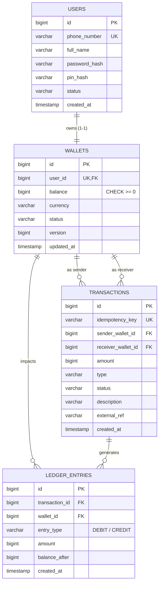

# E-Wallet Core Backend Service - Technical Design Specification

**Document ID:** `2026-11-19-ewallet-core-design`  
**Author:** AI Engineering Assistant & User  
**Status:** In Review  
**Target Milestone:** Core Wallet Engine (P2P Transfer, Top-up, Double-Entry Ledger, MySQL, Spring Data JPA, Redis)

---

## 1. Executive Summary & Intent

The **E-Wallet Core Backend (`vwallet`)** provides the mission-critical financial backbone for an e-wallet platform. It manages user balances, executes real-time Peer-to-Peer (P2P) transfers, processes external top-up operations through payment gateways (e.g., VNPay, Mock Bank), and enforces a strict, immutable **Double-Entry Ledger (Sổ cái kế toán kép)**.

The design guarantees:
1. **Absolute Financial Integrity (ACID):** Every balance movement is backed by paired debit/credit ledger records.
2. **Deadlock-Free Concurrency:** Enforces deterministic resource ordering when locking multiple wallets.
3. **Idempotent Operations:** Prevents double-spending, duplicate transfers, or replayed webhooks under network latency or retries.
4. **Developer-Friendly Local Setup:** Self-contained development environment using Docker Compose (MySQL 8 + Redis 7).

---

## 2. Goals, Non-Goals, and Anti-Goals

### 2.1 Goals
- **Strict Double-Entry Bookkeeping:** Balances never mutate in isolation. Every state change produces balanced, immutable `ledger_entries`.
- **Zero Race Conditions & Negative Balances:** Guaranteed via database-level `CHECK (balance >= 0)` constraints and deterministic row-level locks (`Pessimistic Write` / `SELECT ... FOR UPDATE` ordered ascending by `wallet_id`).
- **Distributed Idempotency:** API requests with an `Idempotency-Key` are locked and cached via Redis (`SETNX` + TTL) to prevent duplicate processing.
- **2-Phase Gateway Top-up:** Implements order initiation (`PENDING`) with HMAC-SHA512 signature creation, followed by secure, idempotent webhook processing.
- **Clean Architecture & Maintainability:** Built with Spring Boot, Spring Data JPA / Hibernate, MySQL 8.0 (InnoDB), and Redis.

### 2.2 Non-Goals
- **Multi-Currency Support:** All balances and transactions are strictly denominated in Vietnamese Dong (`VND`).
- **Complex KYC Verification:** Basic user onboarding with phone number and BCrypt-hashed password/PIN is assumed.
- **Distributed Microservices Mesh:** Core wallet engine is structured as a modular monolith for maximum transactional consistency.
- **Payment Gateway Live Credentials:** Will support standard VNPay parameters and sandbox/mock gateway modes.

### 2.3 Anti-Goals (System Invariants)
- **NO Unaudited Balance Mutations:** Direct balance updates without corresponding `ledger_entries` are strictly prohibited.
- **NO Negative Balances:** A user wallet balance must never drop below 0.
- **NO Deadlocks under Concurrent Bidirectional Transfers:** If User A transfers to User B while User B transfers to User A simultaneously, the system must not deadlock.
- **NO Double Deductions / Duplicate Webhook Executions:** Multiple clicks or gateway callback retries must be safely ignored or return cached receipt data.

---

## 3. Technology Stack & Architecture Decisions

### 3.1 Approaches Considered

| Approach | Technology Stack | Trade-offs | Decision |
| :--- | :--- | :--- | :--- |
| **Option A** | PostgreSQL + Spring Data JDBC | Explicit SQL queries, strict Postgres ACID, already configured in starter pom. | Rejected by User in favor of MySQL & JPA. |
| **Option B (Selected)** | **MySQL 8.0 (InnoDB) + Spring Data JPA (Hibernate) + Redis** | Industry-standard ORM, declarative entity mapping, pessimistic locking natively supported, seamless alignment with user's ERD & sequence diagrams. | **APPROVED**. |
| **Option C** | Event-Sourcing with Apache Kafka as primary source of truth | Extreme write throughput, but adds eventual consistency complexity and non-trivial reconciliation for real-time balance queries. | Deferred for future analytics/event streaming. |

### 3.2 Core Dependencies
- **Runtime:** Java 25 / Spring Boot 3.x/4.x
- **Persistence:** `spring-boot-starter-data-jpa`, `com.mysql:mysql-connector-j`
- **Cache & Concurrency:** `spring-boot-starter-data-redis` (Jedis/Lettuce), Redis 7
- **Security & Crypto:** `spring-boot-starter-security` (BCryptPasswordEncoder), Commons Codec / Java Cryptography (HMAC-SHA512)
- **Utilities:** Lombok, Validation (`jakarta.validation-api`)

---

## 4. Data Architecture & Database Schema

The database uses the InnoDB engine with `utf8mb4` encoding and row-level locking.

### 4.1 ERD & Relational Model



### 4.2 DDL Specifications (MySQL 8.0 InnoDB)

```sql
-- 1. Users table
CREATE TABLE users (
    id BIGINT AUTO_INCREMENT PRIMARY KEY,
    phone_number VARCHAR(15) NOT NULL UNIQUE,
    full_name VARCHAR(100) NOT NULL,
    password_hash VARCHAR(255) NOT NULL,
    pin_hash VARCHAR(255) NULL,
    status VARCHAR(20) NOT NULL DEFAULT 'ACTIVE',
    created_at TIMESTAMP NOT NULL DEFAULT CURRENT_TIMESTAMP,
    INDEX idx_users_phone (phone_number)
) ENGINE=InnoDB DEFAULT CHARSET=utf8mb4;

-- 2. Wallets table (System Wallet id = 1)
CREATE TABLE wallets (
    id BIGINT AUTO_INCREMENT PRIMARY KEY,
    user_id BIGINT NOT NULL UNIQUE,
    balance BIGINT NOT NULL DEFAULT 0,
    currency VARCHAR(10) NOT NULL DEFAULT 'VND',
    status VARCHAR(20) NOT NULL DEFAULT 'ACTIVE',
    version BIGINT NOT NULL DEFAULT 0,
    updated_at TIMESTAMP NOT NULL DEFAULT CURRENT_TIMESTAMP ON UPDATE CURRENT_TIMESTAMP,
    CONSTRAINT fk_wallets_user FOREIGN KEY (user_id) REFERENCES users(id),
    CONSTRAINT chk_wallets_balance CHECK (balance >= 0)
) ENGINE=InnoDB DEFAULT CHARSET=utf8mb4;

-- 3. Transactions table
CREATE TABLE transactions (
    id BIGINT AUTO_INCREMENT PRIMARY KEY,
    idempotency_key VARCHAR(64) NOT NULL UNIQUE,
    sender_wallet_id BIGINT NOT NULL,
    receiver_wallet_id BIGINT NOT NULL,
    amount BIGINT NOT NULL,
    type VARCHAR(20) NOT NULL, -- 'TOPUP', 'P2P_TRANSFER', 'WITHDRAW'
    status VARCHAR(20) NOT NULL, -- 'PENDING', 'COMPLETED', 'FAILED'
    description VARCHAR(255) NULL,
    external_ref VARCHAR(100) NULL,
    created_at TIMESTAMP NOT NULL DEFAULT CURRENT_TIMESTAMP,
    CONSTRAINT fk_tx_sender FOREIGN KEY (sender_wallet_id) REFERENCES wallets(id),
    CONSTRAINT fk_tx_receiver FOREIGN KEY (receiver_wallet_id) REFERENCES wallets(id),
    INDEX idx_tx_sender (sender_wallet_id),
    INDEX idx_tx_receiver (receiver_wallet_id),
    INDEX idx_tx_created (created_at)
) ENGINE=InnoDB DEFAULT CHARSET=utf8mb4;

-- 4. Ledger Entries table (Append-only)
CREATE TABLE ledger_entries (
    id BIGINT AUTO_INCREMENT PRIMARY KEY,
    transaction_id BIGINT NOT NULL,
    wallet_id BIGINT NOT NULL,
    entry_type VARCHAR(10) NOT NULL, -- 'DEBIT' or 'CREDIT'
    amount BIGINT NOT NULL,
    balance_after BIGINT NOT NULL,
    created_at TIMESTAMP NOT NULL DEFAULT CURRENT_TIMESTAMP,
    CONSTRAINT fk_le_tx FOREIGN KEY (transaction_id) REFERENCES transactions(id),
    CONSTRAINT fk_le_wallet FOREIGN KEY (wallet_id) REFERENCES wallets(id),
    INDEX idx_le_wallet (wallet_id),
    INDEX idx_le_tx (transaction_id)
) ENGINE=InnoDB DEFAULT CHARSET=utf8mb4;
```

### 4.3 System Account Bootstrap (Seed Data) & Accounting Semantics
The system must pre-populate:
- User ID = 1: `SYSTEM_USER` (Phone: `0000000000`, Name: `Hệ Thống Ví V-Wallet`, Status: `ACTIVE`)
- Wallet ID = 1: `SYSTEM_WALLET` (User ID = 1, initial balance: `1,000,000,000,000` VND for funding/top-up clearing).

*(Builder Decision: `SYSTEM_WALLET` hoạt động như tài khoản vốn đối ứng/clearing cho các giao dịch nạp tiền. Trong milestone 1, việc khóa bản ghi hàng đợi theo thứ tự `min(1, userWalletId)` đảm bảo tính tuần tự tuyệt đối mà không gây nghẽn nghiêm trọng cho tải dev/staging. Hướng mở rộng cho high-throughput trong tương lai sẽ là áp dụng multi-bucket system wallets).*

---

## 5. Detailed Business Logic & Workflow Specifications

### 5.1 Luồng 1: Chuyển tiền nội bộ (P2P Transfer)

#### 5.1.1 Quy trình thực thi tuần tự
1. **Idempotency Gate (Redis):**
   - Check key `idempotency:transfer:{key}` using `SETNX` with a 120-second TTL (status: `PROCESSING`).
   - If key exists and status is `COMPLETED`, immediately return the cached receipt payload.
   - If key exists and status is `PROCESSING`, reject request with `409 Conflict` (giao dịch đang được xử lý).
2. **PIN Verification & Early Validation:**
   - Retrieve sender's `pin_hash` via `IUserService`.
   - Validate input PIN using BCrypt. If invalid, **evict the Redis `PROCESSING` key immediately** and throw `InvalidPinException` (400 Bad Request) so the user can re-attempt with corrected PIN without being blocked for 120s.
3. **Deadlock Prevention Algorithm:**
   - Identify sender wallet ID ($W_{sender}$) and receiver wallet ID ($W_{receiver}$).
   - Order the IDs: $W_{first} = \min(W_{sender}, W_{receiver})$, $W_{second} = \max(W_{sender}, W_{receiver})$.
   - Execute JPA Pessimistic Write locks sequentially:
     ```java
     walletRepository.findByIdForUpdate(firstId);
     walletRepository.findByIdForUpdate(secondId);
     ```
   - This ensures all threads acquire locks in identical global order (ascending), mathematically eliminating circular wait conditions (deadlocks).
4. **Validation & Balance Check:**
   - Verify both wallets are in `ACTIVE` status.
   - Verify $Balance_{sender} \ge Amount$. If insufficient, **evict the Redis `PROCESSING` key immediately**, execute rollback, and throw `InsufficientBalanceException` (400 Bad Request).
   - *(Note: Following the sequence diagram, failed P2P validations do not pollute the `transactions` table with phantom records; the transaction rolls back cleanly).*
5. **Atomic Execution (`@Transactional`):**
   - Deduct sender balance: $Balance_{sender}^{new} = Balance_{sender} - Amount$.
   - Credit receiver balance: $Balance_{receiver}^{new} = Balance_{receiver} + Amount$.
   - Insert `Transaction`: `type = P2P_TRANSFER`, `status = COMPLETED`.
   - Insert `LedgerEntry` 1: `wallet_id = W_{sender}`, `entry_type = DEBIT`, `amount = Amount`, `balance_after = Balance_{sender}^{new}`.
   - Insert `LedgerEntry` 2: `wallet_id = W_{receiver}`, `entry_type = CREDIT`, `amount = Amount`, `balance_after = Balance_{receiver}^{new}`.
6. **Post-Commit & Cache Result:**
   - Update Redis key with the completed receipt payload (TTL: 24 hours).
   - Return `TransferResponse` DTO (HTTP 200 OK).

---

### 5.2 Luồng 2: Nạp tiền từ Cổng thanh toán (Top-up Gateway)

#### 5.2.1 Pha 1: Khởi tạo lệnh nạp tiền (Pending Order)
1. User gửi yêu cầu: `POST /api/v1/payments/topup` với `amount` (e.g., 500,000 VND).
2. Hệ thống kiểm tra ví của user (`ACTIVE`).
3. Tạo bản ghi `transactions`:
   - `idempotency_key` = Generated unique transaction reference (e.g., `TOPUP_1732000000_USERID`).
   - `sender_wallet_id` = `1` (SYSTEM_WALLET).
   - `receiver_wallet_id` = `userWallet.getId()`.
   - `amount` = request amount.
   - `type` = `TOPUP`.
   - `status` = `PENDING`.
4. Sinh URL thanh toán VNPay / Mock Gateway:
   - Các tham số: `vnp_Version`, `vnp_Command=pay`, `vnp_TmnCode`, `vnp_Amount`, `vnp_TxnRef = transaction.getId()`, `vnp_OrderInfo`, `vnp_ReturnUrl`, `vnp_CreateDate`.
   - Tính chữ ký bảo mật: $SecureHash = \text{HMAC-SHA512}(SecretKey, queryString)$.
   - Ghép `paymentUrl = vnp_Url + "?" + queryString + "&vnp_SecureHash=" + SecureHash`.
5. Trả về cho Mobile Client: `{ "transactionId": 123, "paymentUrl": "..." }`.

#### 5.2.2 Pha 2: Xử lý Webhook Callback (IPN)
1. Gateway gọi endpoint: `POST /api/v1/payments/webhook` (hoặc VNPay IPN).
2. **Kiểm tra chữ ký (Security Check):**
   - Tách `vnp_SecureHash` khỏi payload.
   - Sắp xếp các tham số theo thứ tự alphabet và tính lại HMAC-SHA512 với `SecretKey`.
   - So sánh hằng chuỗi (constant-time compare). Nếu không khớp: trả về `{ "RspCode": "97", "Message": "Invalid Checksum" }`.
3. **Idempotent Webhook Check:**
   - Tra cứu `Transaction` theo `vnp_TxnRef`.
   - Nếu không tìm thấy: trả về `{ "RspCode": "01", "Message": "Order Not Found" }`.
   - Nếu `status != PENDING`: Giao dịch đã được xử lý trước đó $\rightarrow$ Trả về ngay `{ "RspCode": "00", "Message": "Order already confirmed" }` (không cộng tiền lần 2).
4. **Xử lý hạch toán thành công (`vnp_ResponseCode == '00'`):**
   - Mở giao dịch `@Transactional`.
   - Khóa bản ghi giao dịch: `SELECT ... FROM transactions WHERE id = ? FOR UPDATE`.
   - Khóa ví theo thứ tự ID: `min(1, userWalletId)` và `max(1, userWalletId)`.
   - Cập nhật ví hệ thống: $Balance_{sys} = Balance_{sys} - Amount$.
   - Cập nhật ví người dùng: $Balance_{user} = Balance_{user} + Amount$.
   - Cập nhật transaction: `status = 'COMPLETED'`, `external_ref = vnp_TransactionNo`.
   - Ghi sổ cái:
     - `DEBIT` Ví Hệ thống (amount = Amount, balance_after = $Balance_{sys}^{new}$).
     - `CREDIT` Ví Người dùng (amount = Amount, balance_after = $Balance_{user}^{new}$).
   - Commit transaction.
5. **Xử lý thất bại (`vnp_ResponseCode != '00'`):**
   - Cập nhật transaction: `status = 'FAILED'`, `external_ref = vnp_TransactionNo`.
   - Không biến động số dư, không tạo ledger entry.
6. Phản hồi Gateway: `{ "RspCode": "00", "Message": "Confirm Success" }`.

---

## 6. API Contracts (REST Specifications)

### 6.1 P2P Transfer
- **Endpoint:** `POST /api/v1/transfers`
- **Headers:**
  - `Content-Type: application/json`
  - `Idempotency-Key: <UUID-v4>` (Bắt buộc)
  - `X-User-Id: <Long>` (Giả định xác thực người gửi từ token/header)
- **Request Body:**
  ```json
  {
    "receiverPhone": "0987654321",
    "amount": 100000,
    "pin": "123456",
    "description": "Chuyen tien an trua"
  }
  ```
- **Response 200 OK:**
  ```json
  {
    "success": true,
    "transactionId": 1001,
    "senderWalletId": 2,
    "receiverWalletId": 5,
    "amount": 100000,
    "status": "COMPLETED",
    "createdAt": "2026-11-19T19:30:00Z"
  }
  ```
- **Error Codes:**
  - `400 Bad Request`: `INVALID_PIN`, `INSUFFICIENT_BALANCE`, `RECEIVER_NOT_FOUND`, `SELF_TRANSFER_NOT_ALLOWED`.
  - `409 Conflict`: `TRANSACTION_IN_PROGRESS`.

### 6.2 Initiate Top-up
- **Endpoint:** `POST /api/v1/payments/topup`
- **Headers:** `X-User-Id: <Long>`
- **Request Body:**
  ```json
  {
    "amount": 500000
  }
  ```
- **Response 200 OK:**
  ```json
  {
    "transactionId": 2002,
    "paymentUrl": "https://sandbox.vnpayment.vn/paymentv2/vpcpay.html?vnp_Amount=50000000&vnp_Command=pay&..."
  }
  ```

### 6.3 Gateway Webhook Callback (IPN)
- **Endpoint:** `POST /api/v1/payments/webhook`
- **Query / Form Parameters:** `vnp_Amount`, `vnp_TxnRef`, `vnp_ResponseCode`, `vnp_TransactionNo`, `vnp_SecureHash`, ...
- **Response 200 OK:**
  ```json
  {
    "RspCode": "00",
    "Message": "Confirm Success"
  }
  ```

### 6.4 Client Return & Status Query Endpoints (Builder Call)
- **Endpoint:** `GET /api/v1/payments/vnpay-return`
  - Handler cho người dùng sau khi hoàn tất màn hình thanh toán VNPay Webview.
  - Kiểm tra chữ ký `vnp_SecureHash`, đọc trạng thái giao dịch hiện tại và trả về trang HTML/JSON thông báo kết quả thân thiện hoặc redirect deep-link về ứng dụng di động.
- **Endpoint:** `GET /api/v1/transactions/{id}`
  - Cho phép Mobile App tra cứu trạng thái giao dịch (`PENDING`, `COMPLETED`, `FAILED`) để polling cập nhật UI sau khi nạp tiền.
- **Endpoint:** `GET /api/v1/wallets/me`
  - Headers: `X-User-Id: <Long>`
  - Trả về thông tin ví và số dư hiện tại của người dùng.

---

## 7. Infrastructure & Environment (`docker-compose.yml`)

File cấu hình môi trường đặt tại `docker/docker-compose.yml`:

```yaml
version: '3.8'

services:
  mysql:
    image: mysql:8.0
    container_name: vwallet-mysql
    restart: always
    environment:
      MYSQL_ROOT_PASSWORD: rootpassword
      MYSQL_DATABASE: vwallet
      MYSQL_USER: vwallet_user
      MYSQL_PASSWORD: vwallet_password
    ports:
      - "3306:3306"
    volumes:
      - mysql_data:/var/lib/mysql
    command: --default-authentication-plugin=mysql_native_password

  redis:
    image: redis:7-alpine
    container_name: vwallet-redis
    restart: always
    ports:
      - "6379:6379"
    volumes:
      - redis_data:/data

volumes:
  mysql_data:
  redis_data:
```

---

## 8. What is Left to the Builder (Implementation Details)

The builder has full authority over the following implementation details:
1. **Package Organization:** Standard layout under `com.meme.vwallet`:
   - `controller`, `service`, `repository`, `entity`, `dto`, `exception`, `config`.
2. **Repository Interfaces:** Defining Spring Data JPA repository methods (e.g., `@Lock(LockModeType.PESSIMISTIC_WRITE)`).
3. **Mock Gateway Engine:** Providing a mock HTML/redirect simulator for testing top-up end-to-end without real VNPay credentials.
4. **Automated Tests:** Writing integration tests with `@SpringBootTest` and mock services verifying deadlock freedom and idempotency.

---

## 9. Review and Next Steps

- This document serves as the formal blueprint.
- Once approved, we will invoke `superpowers:writing-plans` to generate an actionable, step-by-step implementation plan.
