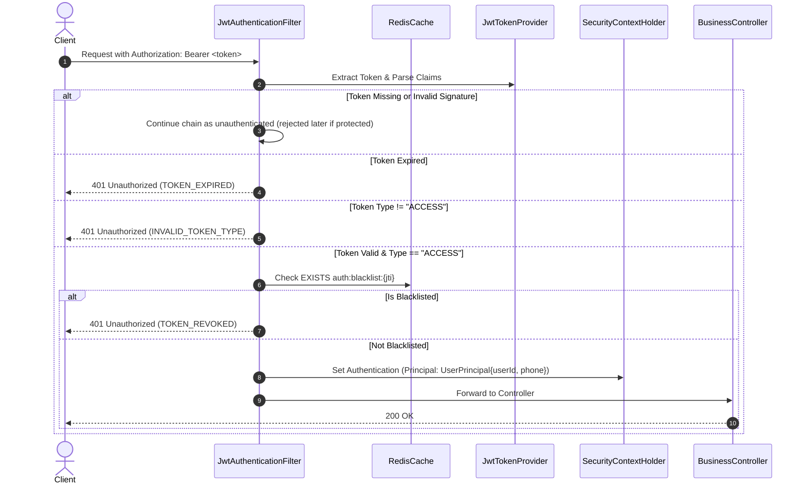

# Phase B Design Specification: Authentication & Authorization with Spring Security 6 & JWT

- **Project:** VWallet (Core E-Wallet Engine)
- **Module:** `ewallet-backend`
- **Author:** Antigravity AI & VuongDuongg
- **Date:** 2026-11-23
- **Status:** Draft (Awaiting Builder Check & Approval)

---

## 1. Intent & The Why

In **Phase A**, the core transaction engines (Double-Entry Ledger accounting, deadlock-free P2P transfers via deterministic lock ordering, Redis `SETNX` distributed idempotency, and VNPay top-up gateway) were built and verified with 102/102 automated tests. To unblock the core engine development, authentication was abstracted via a temporary `X-User-Id` request header resolved by `CurrentUserArgumentResolver`.

In a production environment, relying on an unauthenticated client-supplied header `X-User-Id` is insecure and prone to identity spoofing. **Phase B** establishes an enterprise-grade, stateless security architecture powered by **Spring Security 6** and **JSON Web Tokens (JWT)**. It provides complete user lifecycle management (registration, login, refresh token rotation, logout with immediate token blacklisting) and secures all wallet/payment APIs while keeping zero friction for existing Phase A service contracts.

---

## 2. Goals, Non-Goals, & Anti-Goals

### 2.1. Goals
1. **User Registration (`POST /api/v1/auth/register`):**
   - Accept phone number, full name, and password.
   - Enforce phone number canonicalization (normalize `+84...` to `0...` standard 10-digit domestic format) and password complexity.
   - Automatically initialize a default wallet for the new user with `balance = 0`, `currency = 'VND'`, `version = 0`, and status `ACTIVE`.
2. **User Login (`POST /api/v1/auth/login`):**
   - Apply phone number canonicalization (`+84...` to `0...`) before lookup.
   - Authenticate credentials via `BCryptPasswordEncoder`.
   - Issue a short-lived **Access Token** (TTL: 15 minutes) and a long-lived **Refresh Token** (TTL: 7 days).
   - Return user metadata including `hasPin` (boolean) to notify clients whether PIN setup is required.
3. **Refresh Token Lifecycle & Rotation (`POST /api/v1/auth/refresh`):**
   - Store active refresh tokens in Redis under `auth:refresh:{userId}` (holding active `tokenId`) with a 7-day TTL.
   - Enforce **Refresh Token Rotation (RTR)**: when a valid refresh token is exchanged, it is immediately rotated, and a newly generated pair (Access Token + new Refresh Token) is issued.
   - Detect refresh token reuse: if an invalidated or non-existent token is submitted after the grace period, revoke active sessions for that user.
4. **Immediate Logout & Invalidation (`POST /api/v1/auth/logout`):**
   - Evict the user's refresh token from Redis (`DEL auth:refresh:{userId}`).
   - Extract the Access Token's `jti` (JWT ID) and write an entry `auth:blacklist:{jti}` to Redis with a TTL equal to the token's remaining lifetime, ensuring immediate revocation across all microservice instances before natural JWT expiration.
5. **Post-Login Transaction PIN Setup (`POST /api/v1/users/pin`):**
   - Allow users to set their 6-digit transaction PIN after registration if `hasPin == false`.
   - If user already has a PIN configured, return HTTP 400 Bad Request with error code `PIN_ALREADY_SET`.
   - Differentiate error responses clearly during transaction execution:
     - `PIN_NOT_SET` (HTTP 400): user attempts a transfer but has never configured a PIN.
     - `INVALID_PIN` (HTTP 400/401): user has configured a PIN but provided an incorrect one.
6. **Stateless Security Filter Chain & `@CurrentUser` Resolver Migration:**
   - Implement `JwtAuthenticationFilter` (`OncePerRequestFilter`) to validate `Bearer <token>`, verify signature/expiration, enforce token claim `type == "ACCESS"`, and ensure `jti` is not blacklisted in Redis.
   - Update `CurrentUserArgumentResolver` to extract the authenticated `userId` strictly from `SecurityContextHolder`. Remove all fallback `X-User-Id` header parsing to eliminate identity spoofing vulnerabilities.
   - Whitelist public endpoints:
     - Public: `/api/v1/auth/register`, `/api/v1/auth/login`, `/api/v1/auth/refresh`, `/api/v1/payments/webhook`, `/api/v1/payments/vnpay-return`, Swagger/OpenAPI docs, Actuator health.
     - Authenticated: `/api/v1/auth/logout`, `/api/v1/users/**`, `/api/v1/transfers/**`, `/api/v1/wallets/**`, `/api/v1/payments/topup`, and transaction details (enforcing IDOR protection via sender/receiver wallet ownership verification).

### 2.2. Non-Goals
- OAuth2 / Social Login (Google, Apple, Facebook) — deferred to Phase D.
- Role-based Access Control (RBAC) / Multi-role permissions (e.g., ADMIN, AUDITOR, USER) — only `ROLE_USER` is needed for Phase B.
- External SMS OTP verification provider (Twilio, Stringee) — account registration verifies passwords directly; OTP 2FA can be plugged in during Phase D.

### 2.3. Anti-Goals
- **No Plaintext Credential Storage:** Passwords and PINs must never be logged or stored unhashed. Passwords and PINs use BCrypt with distinct salt rounds.
- **No Stateful Server Sessions:** The backend must remain strictly stateless; no HTTP sessions (`SessionCreationPolicy.STATELESS`).
- **No Database Polling for Revoked Tokens:** Token blacklisting must rely on Redis fast in-memory key lookups, not synchronous SQL queries.
- **No Regression in Core Engine:** Phase A test suite (102 tests, multi-threaded transfer deadlock tests, idempotency tests) must continue to pass cleanly.

---

## 3. Architecture & Technical Decisions

### 3.1. Approaches Evaluated

| Component | Approach 1 (Selected) | Approach 2 (Rejected) | Trade-off / Justification |
| :--- | :--- | :--- | :--- |
| **Session Model** | **Single-Device Active Session** (`auth:refresh:{userId}`) | **Multi-Device Concurrent Sessions** | **Selected Approach 1:** Standard for e-wallets (MoMo, ZaloPay). When logging in on a new device, old session is automatically invalidated. Eliminates wildcard `KEYS` queries in Redis. |
| **Refresh Token Storage** | **Redis Key-Value** (`auth:refresh:{userId}` holding active `tokenId`) with 7d TTL | **MySQL Table** (`refresh_tokens` table with foreign key to `users`) | **Selected Approach 1:** Redis is already operational in the stack; auto-expires keys without batch cleanup jobs; avoids synchronous DB I/O on every token refresh. |
| **RTR Concurrency Handling** | **30-Second Grace Period** via Redis cache (`auth:rotated:{oldTokenId}`) | **Strict Immediate Invalidation without Grace Period** | **Selected Approach 1:** Mobile clients encountering token expiry often fire multiple concurrent background requests; 30s grace period returns the rotated token pair idempotently, avoiding false-positive breach lockouts. |
| **Access Token Invalidation** | **Redis Blacklist by `jti`** (`auth:blacklist:{jti}`) with remaining TTL | **Short TTL only without blacklist** (wait out 15m expiration) | **Selected Approach 1:** Immediate logout is a financial compliance requirement for fintech/e-wallets to prevent session hijacking upon device loss. |
| **PIN Initialization** | **Two-stage activation:** PIN set via `/api/v1/users/pin` post-login; `hasPin` flag returned | **Single-stage:** PIN required in `/register` payload | **Selected Approach 1:** Aligns with standard fintech onboarding (onboard phone/password first, set PIN in a dedicated secure numeric keypad screen). Matches existing nullable `pin_hash` column. |

---

## 4. Detailed Design & Specifications

### 4.1. Data Models & Database Schema

The existing `users` table from Phase A:
```sql
CREATE TABLE IF NOT EXISTS users (
    id BIGINT AUTO_INCREMENT PRIMARY KEY,
    phone_number VARCHAR(15) NOT NULL UNIQUE,
    full_name VARCHAR(100) NOT NULL,
    password_hash VARCHAR(255) NOT NULL,
    pin_hash VARCHAR(255) NULL,
    status VARCHAR(20) NOT NULL DEFAULT 'ACTIVE',
    created_at TIMESTAMP NOT NULL DEFAULT CURRENT_TIMESTAMP
);
```
*Note:* No schema migration required for `users`. Column `pin_hash` is already nullable.
When a user registers, a record is also inserted into `wallets`:
```sql
INSERT INTO wallets (user_id, balance, currency, status, version, created_at, updated_at)
VALUES (:userId, 0, 'VND', 'ACTIVE', 0, CURRENT_TIMESTAMP, CURRENT_TIMESTAMP);
```

### 4.2. Redis Key Namespace Specifications

| Redis Key Pattern | Type | Value Payload | TTL | Purpose |
| :--- | :--- | :--- | :--- | :--- |
| `auth:refresh:{userId}` | String | Active `tokenId` (UUID) | 7 days (604,800s) | Tracks currently active refresh token for the user (Single-Device session model) |
| `auth:refresh_lock:{userId}` | String | `"LOCKED"` | 5 seconds | Distributed short lock preventing race condition lockouts during parallel mobile refreshes |
| `auth:rotated:{oldTokenId}` | String | Serialized `AuthResponse` JSON | Configurable (Default 30s) | RTR Grace Period: allows parallel concurrent mobile requests to receive the new pair safely without breach lockout |
| `auth:blacklist:{jti}` | String | `"REVOKED"` | Token's remaining lifetime (Max 900s) | Blocks compromised or logged-out Access Tokens immediately |

### 4.3. JWT Structure & Claims (Token Type Confusion Defense)

- **Algorithm:** HMAC-SHA256 (`HS256`) using a 256-bit secret key configured in `application.yaml` (`vwallet.jwt.secret`).
- **Access Token Claims:**
  - `sub`: `userId` (String, e.g., `"2"`)
  - `phone`: `phoneNumber` (String, e.g., `"0900000001"`)
  - `name`: `fullName`
  - `type`: `"ACCESS"` (Mandatory: defends against Token Type Confusion attacks)
  - `jti`: Unique UUID string (e.g., `"a3e8...-..."`)
  - `iat`: Issued at timestamp
  - `exp`: Expiration timestamp (iat + 900s / 15 minutes)
- **Refresh Token Claims:**
  - `sub`: `userId`
  - `type`: `"REFRESH"` (Mandatory: defends against Token Type Confusion attacks)
  - `jti`: Unique `tokenId` (UUID)
  - `iat`: Issued at timestamp
  - `exp`: Expiration timestamp (iat + 604800s / 7 days)

### 4.4. API Endpoints Specification

#### 4.4.1. `POST /api/v1/auth/register` (Public)
- **Request Body:**
  ```json
  {
    "phoneNumber": "0912345678",
    "fullName": "Nguyen Van A",
    "password": "Password123@"
  }
  ```
  - Validation:
    - `phoneNumber`: Not blank, regex `^(\\+84|0)[3|5|7|8|9][0-9]{8}$`
    - `fullName`: Not blank, 2 - 100 characters
    - `password`: Not blank, min 8 chars, at least 1 digit, 1 letter
- **Processing Logic:**
  1. Canonicalize `phoneNumber` (normalize `+84...` to `0...`, 10 digits).
  2. Check if `phoneNumber` exists via `userRepository.existsByPhoneNumber(...)`. If exists, throw `UserAlreadyExistsException` (HTTP 409).
  3. Hash password with `passwordEncoder.encode(password)`.
  4. Save `User` entity with `status = "ACTIVE"`.
  5. Create and save new `Wallet` entity for user with `balance = 0`, `currency = "VND"`, `version = 0`, and `status = ACTIVE`.
  6. Generate Access Token (`type = "ACCESS"`, TTL 15m) & Refresh Token (`type = "REFRESH"`, TTL 7d). Store active Refresh Token in Redis: `auth:refresh:{userId}` with value `tokenId` (TTL 7d).
- **Response (HTTP 201 Created):**
  ```json
  {
    "userId": 4,
    "phoneNumber": "0912345678",
    "fullName": "Nguyen Van A",
    "hasPin": false,
    "accessToken": "eyJhbGciOi...",
    "refreshToken": "eyJhbGciOi...",
    "tokenType": "Bearer",
    "expiresIn": 900
  }
  ```

#### 4.4.2. `POST /api/v1/auth/login` (Public)
- **Request Body:**
  ```json
  {
    "phoneNumber": "0912345678",
    "password": "Password123@"
  }
  ```
- **Processing Logic:**
  1. Canonicalize `phoneNumber` (normalize `+84...` to `0...`, 10 digits).
  2. Query user by canonical `phoneNumber`. If not found, throw `BadCredentialsException` (HTTP 401).
  3. Verify password via `passwordEncoder.matches(...)`. If false, throw `BadCredentialsException` (HTTP 401).
  4. Verify `user.getStatus() == "ACTIVE"`. If inactive, throw `UserLockedException` (HTTP 403).
  5. Generate Access Token (`type = "ACCESS"`, TTL 15m) and Refresh Token (`type = "REFRESH"`, TTL 7d) with unique `jti`.
  6. Store Refresh Token in Redis: `auth:refresh:{userId}` with value `tokenId` (TTL 7d) — automatically invalidating any previous session (Single-Device model).
  7. Determine `hasPin = (user.getPinHash() != null && !user.getPinHash().isBlank())`.
- **Response (HTTP 200 OK):**
  ```json
  {
    "userId": 4,
    "phoneNumber": "0912345678",
    "fullName": "Nguyen Van A",
    "hasPin": false,
    "accessToken": "eyJhbGciOi...",
    "refreshToken": "eyJhbGciOi...",
    "tokenType": "Bearer",
    "expiresIn": 900
  }
  ```

#### 4.4.3. `POST /api/v1/auth/refresh` (Public)
- **Request Body:**
  ```json
  {
    "refreshToken": "eyJhbGciOi..."
  }
  ```
- **Processing Logic (Refresh Token Rotation with 30s Grace Period & Distributed Lock):**
  1. Parse and validate signature and expiry of `refreshToken`. If invalid/expired, return HTTP 401 Unauthorized.
  2. Extract `userId`, `tokenId` (`jti`), and `type` claim from the refresh token.
  3. **Token Type Confusion Defense:** Verify `type == "REFRESH"`. If missing or not `"REFRESH"`, reject immediately with HTTP 401 Unauthorized (`INVALID_TOKEN_TYPE`).
  4. **Fast-Path (Grace Period Cache):** Check if key `auth:rotated:{tokenId}` exists in Redis:
     - If exists: Return the cached `AuthResponse` directly. (Handles concurrent mobile requests arriving within the 30-second window idempotently).
  5. **Concurrency & Race Condition Handling via Short Redis Lock:**
     - Attempt to acquire short lock: `SET auth:refresh_lock:{userId} "LOCKED" NX EX 5`.
     - If lock acquisition fails (meaning another concurrent thread for this user is currently rotating the token):
       - Wait/poll briefly (up to 3 times with 100ms interval) and re-check `auth:rotated:{tokenId}`. If found, return cached response.
     - Once inside the protected section, perform a secondary check on `auth:rotated:{tokenId}`. If present now, release lock and return cached response.
     - Query Redis key `auth:refresh:{userId}`:
       - **Case A: Key does not exist or value != `tokenId`** $\rightarrow$ Token Reuse / Security Breach Detected!
         - Action: Release lock and delete `auth:refresh:{userId}` immediately.
         - Return HTTP 401 Unauthorized with error code `TOKEN_REUSE_DETECTED` and message `"Phát hiện token đã qua sử dụng hoặc phiên đăng nhập không hợp lệ"`.
       - **Case B: Key exists and value == `tokenId`**:
         - Generate new Access Token (`type = "ACCESS"`, TTL 15m) and new Refresh Token (`type = "REFRESH"`, TTL 7d).
         - Update active token in Redis: `SET auth:refresh:{userId} tokenId_new_refresh EX 604800`.
         - Cache rotated token for Grace Period: `SET auth:rotated:{tokenId} <serialized_response> EX <vwallet.jwt.refresh-grace-period-seconds>` (default 30s).
         - Release lock: `DEL auth:refresh_lock:{userId}`.
         - Return new token pair.
- **Response (HTTP 200 OK):**
  ```json
  {
    "accessToken": "eyJhbGciOi...",
    "refreshToken": "eyJhbGciOi...",
    "tokenType": "Bearer",
    "expiresIn": 900
  }
  ```

#### 4.4.4. `POST /api/v1/auth/logout` (Authenticated)
- **Headers:** `Authorization: Bearer <accessToken>`
- **Request Body:** (Optional)
  ```json
  {
    "refreshToken": "eyJhbGciOi..."
  }
  ```
- **Processing Logic:**
  1. Extract `jti` and remaining lifetime from current Access Token in `SecurityContextHolder`.
  2. Write Redis blacklist entry: `SET auth:blacklist:{jti} "REVOKED" EX <remainingSeconds>`.
  3. Extract `userId` from `@CurrentUser` and delete active session from Redis: `DEL auth:refresh:{userId}`.
- **Response (HTTP 200 OK):**
  ```json
  {
    "success": true,
    "message": "Đăng xuất thành công"
  }
  ```

#### 4.4.5. `POST /api/v1/users/pin` (Authenticated)
- **Headers:** `Authorization: Bearer <accessToken>`
- **Request Body:**
  ```json
  {
    "pin": "123456",
    "confirmPin": "123456"
  }
  ```
- **Processing Logic:**
  1. Validate `pin.matches("^[0-9]{6}$")` and `pin.equals(confirmPin)`.
  2. Get `userId` from `@CurrentUser`.
  3. Check if user already has a PIN configured: if `user.getPinHash() != null && !user.getPinHash().isBlank()`, throw `PinAlreadySetException("Mã PIN giao dịch đã được thiết lập. Không thể cài đặt lại tại endpoint này.")` (HTTP 400 Bad Request, code `PIN_ALREADY_SET`).
  4. Call `userService.setPin(userId, pin)`.
- **Response (HTTP 200 OK):**
  ```json
  {
    "success": true,
    "message": "Cài đặt mã PIN giao dịch thành công"
  }
  ```

#### 4.4.6. `GET /api/v1/users/me` (Authenticated)
- **Headers:** `Authorization: Bearer <accessToken>`
- **Response (HTTP 200 OK):**
  ```json
  {
    "userId": 4,
    "phoneNumber": "0912345678",
    "fullName": "Nguyen Van A",
    "hasPin": true,
    "status": "ACTIVE",
    "createdAt": "2026-11-23T16:30:00Z"
  }
  ```

#### 4.4.7. `GET /api/v1/transactions/{id}` & Ownership (IDOR Defense)
- **Headers:** `Authorization: Bearer <accessToken>`
- **Processing Logic:**
  1. Retrieve `userId` from `@CurrentUser`.
  2. Query `Transaction` by `id`. If not found, throw `TransactionNotFoundException` (HTTP 404).
  3. **IDOR Protection Check:**
     ```java
     Long senderUserId = tx.getSenderWallet() != null ? tx.getSenderWallet().getUserId() : null;
     Long receiverUserId = tx.getReceiverWallet() != null ? tx.getReceiverWallet().getUserId() : null;
     if (!userId.equals(senderUserId) && !userId.equals(receiverUserId)) {
         throw new AccessDeniedException("Bạn không có quyền truy cập thông tin giao dịch này"); // HTTP 403 Forbidden
     }
     ```
  4. Return `TransactionResponse`.

---

### 4.5. PIN Verification Enhancements in Transfer Flow

In `UserService.verifyPin(Long userId, String pin)`:
1. Lookup user.
2. Check `user.getPinHash()`:
   - If `user.getPinHash() == null || user.getPinHash().isBlank()`:
     - Throw `PinNotSetException("Tài khoản chưa cài đặt mã PIN giao dịch. Vui lòng thiết lập mã PIN trước khi thực hiện giao dịch.")` $\rightarrow$ Handled by `GlobalExceptionHandler` returning HTTP 400 Bad Request with code `PIN_NOT_SET`.
   - If `!passwordEncoder.matches(pin, user.getPinHash())`:
     - Throw `InvalidPinException("Mã PIN không chính xác")` $\rightarrow$ Handled by `GlobalExceptionHandler` returning HTTP 400 Bad Request with code `INVALID_PIN`.

---

### 4.6. Security Filter Chain & Context Resolution

#### 4.6.1. `JwtAuthenticationFilter` Pipeline


#### 4.6.2. `CurrentUserArgumentResolver` Refactoring (Zero Fallback)
Update `CurrentUserArgumentResolver.java` to extract `userId` strictly from `SecurityContextHolder`:
```java
@Component
public class CurrentUserArgumentResolver implements HandlerMethodArgumentResolver {

    @Override
    public boolean supportsParameter(MethodParameter parameter) {
        return parameter.hasParameterAnnotation(CurrentUser.class)
                && (Long.class.isAssignableFrom(parameter.getParameterType())
                || long.class.isAssignableFrom(parameter.getParameterType()));
    }

    @Override
    public Object resolveArgument(MethodParameter parameter,
                                  ModelAndViewContainer mavContainer,
                                  NativeWebRequest webRequest,
                                  WebDataBinderFactory binderFactory) {
        Authentication auth = SecurityContextHolder.getContext().getAuthentication();
        if (auth != null && auth.getPrincipal() instanceof UserPrincipal principal) {
            return principal.getUserId();
        }
        throw new ResponseStatusException(HttpStatus.UNAUTHORIZED, "Unauthenticated request");
    }
}
```
*Security Invariant:* All fallback reading of `X-User-Id` is completely eliminated. Tests and API clients must authenticate via signed JWTs or Spring Security Test helpers (`@WithMockUser` or `SecurityContextTestUtils.setAuthenticatedUser(userId)`).

---

## 5. What's Left to the Builder (Implementation Team Calls)

The builder has autonomy over:
1. **JWT Library Selection:** Choice between `io.jsonwebtoken:jjwt-api:0.12.6` (plus `jjwt-impl`, `jjwt-jackson`) or Spring Security's Nimbus JOSE. (`jjwt` is recommended).
2. **Error Response Body Structure:** Standard `ErrorResponse` DTO with `errorCode` and `message`.
3. **Grace Period Property:** Binds `vwallet.jwt.refresh-grace-period-seconds` (default: 30) from `application.yaml`.

---

## 6. Verification & Test Criteria

### 6.1. Unit Tests:
- `JwtTokenProviderTest`: Generate, validate, parse claims, enforce token type (`ACCESS` vs `REFRESH`), check expired token handling.
- `AuthServiceTest`: Mock repository/Redis; test register (canonicalizing phone, creating wallet), login, refresh rotation, race-condition grace period, reuse detection, logout blacklist.
- `UserServiceTest`: Test `verifyPin` throwing `PinNotSetException` vs `InvalidPinException`.

### 6.2. Security Integration Tests:
- **Authentication Protection:** Access protected endpoints (`/api/v1/transfers`, `/api/v1/wallets/me`) without token $\rightarrow$ verify 401 Unauthorized.
- **Valid Token Access:** Access with valid Access Token $\rightarrow$ verify 200 OK.
- **Blacklisted Token Access:** Access with revoked token (after logout) $\rightarrow$ verify 401 Unauthorized (`TOKEN_REVOKED`).
- **Token Type Confusion Tests:**
  - Send a Refresh Token (`type="REFRESH"`) as `Bearer` header to `/api/v1/transfers` $\rightarrow$ Filter rejects with 401 Unauthorized (`INVALID_TOKEN_TYPE`).
  - Send an Access Token (`type="ACCESS"`) in request body to `/api/v1/auth/refresh` $\rightarrow$ Endpoint rejects with 401 Unauthorized (`INVALID_TOKEN_TYPE`).
- **Refresh Token Rotation & Grace Period Tests:**
  - **Case A (Grace Period In-Flight):** Call `/refresh` with `refreshToken1` $\rightarrow$ succeeds, returns `tokenPairA`. Immediately call `/refresh` again with `refreshToken1` within the Grace Period window (e.g. within 30s) $\rightarrow$ returns 200 OK with cached `tokenPairA`.
  - **Case B (Post Grace Period / Breach Detection):** Call `/refresh` with an old/reused token after Grace Period expires $\rightarrow$ returns 401 Unauthorized with code `TOKEN_REUSE_DETECTED`, and asserts that `auth:refresh:{userId}` is deleted from Redis.
- **IDOR Protection Tests:**
  - User C (ID 3) calls `GET /api/v1/transactions/{id}` for a transaction between User A (ID 1) and User B (ID 2) $\rightarrow$ returns 403 Forbidden.
  - User A or User B calls `GET /api/v1/transactions/{id}` $\rightarrow$ returns 200 OK with transaction details.

### 6.3. Regression Tests & Test Migration:
- Update existing Phase A test utilities: inject `UserPrincipal` into `SecurityContextHolder` in test suites (`TransferControllerTest`, `WalletControllerTest`, `PaymentControllerTest`, `P2PTransferDeadlockTest`, `TopupIdempotencyIntegrationTest`).
- Run `./mvnw test` across all 102 existing tests to guarantee zero regressions.
